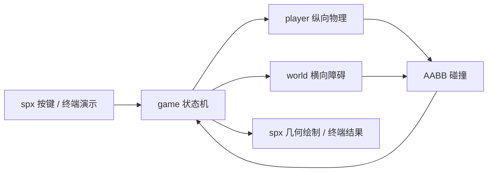

# 架构说明

## 技术边界

核心是 Go 1.22 的无界面游戏逻辑，module 为 `github.com/rxg456/xbuilder-parkour`。
`cmd/simulate` 提供已验证的终端演示；`spx/` 是独立的原生接入模块，
固定依赖 spx v2.0.4 和 XGo v1.7.1，需要 Go 1.25 及完整引擎运行环境。
输入、绘制和资源加载由上层适配器负责，不放入物理或世界模块。
原生源码不代表 XBuilder 网页版已验证可导入或游戏窗口已运行成功。
已通过 `xgo go -t -tags pure_engine .` 的原生入口语法与类型检查；
不带该标签时，本机缺少原生主机绑定，检查失败。这不是画面运行验证。

## 模块分工

| 模块 | 职责 | 依赖 |
| --- | --- | --- |
| `internal/player` | 玩家纵向运动、重力、落地、跳跃限制和玩家重置 | 不依赖 game |
| `internal/world` | 障碍物、横向移动、距离、随机种子、矩形碰撞和世界重置 | 不依赖 game |
| `internal/game` | 状态机、输入入口、协调更新、计分和最高分 | player、world |
| `cmd/simulate` | 固定步长模拟与自动跳跃演示 | game |
| `spx/main.spx` | 按键、舞台监视器、几何线框绘制（待运行验证） | game、spx |
| `.github/workflows/test.yml` | PR 核心测试、静态检查和终端演示（待远程触发） | Go 工具链 |

模块负责人、来源与审核流程见 `team-workflow.md`。

## 接口契约

玩家配置为 `player.Config{GroundY, JumpSpeed, Gravity float64}`；
通过 `DefaultConfig()`、`New(Config) *Player` 创建。
玩家公开 `Y`、`VelocityY` 和 `Grounded`，提供 `Jump() bool`、
`Update(dt)`、`Reset()`。

世界障碍物为 `world.Obstacle{X, Width, Height float64}`。
世界公开 `Obstacles []Obstacle`、`Distance`、`Speed`，
提供 `New(seed int64) *World`、`Update(dt)`、`Reset(seed)` 和
`Collides(playerX, playerY, playerWidth, playerHeight float64) bool`。

坐标 Y 向上；玩家 Y 表示脚底，而非中心或头顶。游戏层固定玩家矩形为
左边 X=160、宽 40、高 64，传给世界模块做碰撞检测。
玩家纵向移动，世界横向移动，不需要游戏层维护摄像机。
spx 适配时将左边为原点的 X 减去 480，地面映射为舞台 Y=-170，
矩形中心由左边、脚底和尺寸换算。适配器夹紧焦点切换后的时间间隔为最多
0.05 秒，物理模块不积累浏览器失焦期间的长时间进度。

## 状态与更新

`State` 是字符串类型，常量为 `Ready`、`Running`、`GameOver`。

| 调用 | 行为 |
| --- | --- |
| `New(seed)` | 创建玩家与世界，状态为 Ready，分数与最高分为 0 |
| `Start()` | 仅将 Ready 转为 Running；其他状态不变 |
| `Jump()` | 仅在 Running 委托玩家跳跃；返回是否接受 |
| `Update(dt)` | 仅在 Running 更新场景；碰撞后转为 GameOver |
| `Restart()` | 用初始种子重置同一玩家与世界对象，回到 Ready，清零分数，保留最高分 |

Ready 和 GameOver 不更新场景，且不能跳跃。GameOver 后必须先 Restart，
再 Start 开始新一局。最高分是当前 Game 实例内的记录，尚无磁盘持久化。
直接调用玩家或世界方法会绕过游戏状态机；上层输入应使用游戏 API。

更新忽略非正数、NaN 和无穷大的 dt。每次最多处理 1 秒，并拆为不超过
1/120 秒的小步，使玩家与世界按同一时间推进。更新前和每个小步后检测碰撞，
碰撞发生即停止本次剩余更新。小步用于降低高速越过障碍物的风险，
不是任意速度下的连续碰撞检测保证；未来极高速玩法需要扫掠碰撞。

分数为 `int(World.Distance / 10)`，正常非负距离下向下取整。
每次小步及碰撞结束时刷新分数；结束时以当前分数更新最高分，
较低的分数不覆盖已有记录。

## 验证与限制

`internal/game/game_test.go` 覆盖初始与结束状态、非运行场景冻结、
起跳与空中拒绝连跳、越过低障碍与下降碰撞、固定矩形横向碰撞、
距离计分、较低分数保留最高分、场景推进、各状态重开、非法 dt 和大 dt 上限。
测试通过真实 player/world 接口集成，不引入替身依赖。

已在本机执行 `go test -cover ./...` 和 `go vet ./...`，均通过。
player、world、game 语句覆盖率分别为 95.2%、97.9%、100%。
`go test -race ./...` 因当前 CGO 未启用无法运行；Linux CI 尚未触发。
原生引擎画面和 XBuilder 云端导入尚未验证，没有已创建的 PR 或 demo 视频。
人类负责人、审核与提交证据要求见 `team-workflow.md`。
