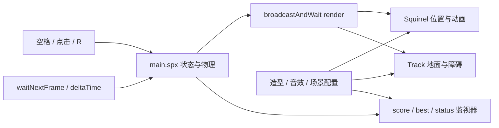
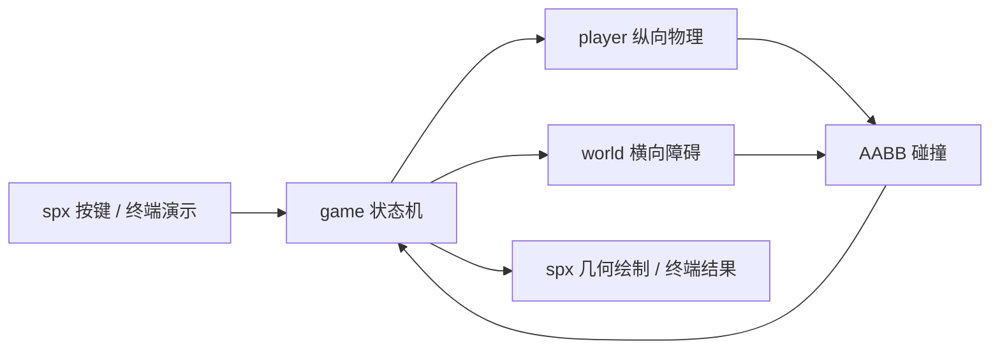

# 架构说明

## 网页版架构

当前可交互版本由 XBuilder 网页编辑器编译、运行，目标引擎为 spx v3.3.0。
`web-native/` 是独立原生项目，不 import Go 核心、不使用本地 `replace`，
也不需要服务器。`parkour-web.xbp` 包含舞台、精灵、配置、动画和音效，
与之前的视口修正版包仅名称不同。用户已反馈该版本可以游玩。
具体导入与操作见 [网页版运行说明](web-running.md)。

### 模块规格与分工

| 模块 | 职责与输入输出 | 建议责任 |
| --- | --- | --- |
| `web-native/main.spx` | 唯一逻辑写入者；接收空格、点击、R 和帧时间，更新共享状态，发送 `render` | rxg456 |
| `web-native/Squirrel.spx` | 读取状态和脚底高度，设置角色位置并切换 Idle、Walk、Jump、Fall 动画 | autoops-dev |
| `web-native/Track.spx` | 读取障碍位置、尺寸；隐藏自身造型，用画笔重绘地面及两个障碍，不更新物理 | autoops-dev |
| `web-native/assets/index.json` | `480×360` 舞台、草地背景、精灵层次及 score/best/status 监视器绑定 | autoops-dev |
| `web-native/assets/sprites/`、`sounds/` | 用户导出的松鼠动画和音效，隐藏绘图精灵的造型与资源索引 | autoops-dev |
| `web-native/builder-meta.json`、缩略图 | 编辑器项目名、说明、操作提示及预览 | jesko-road |
| `parkour-web.xbp`、运行和设计文档 | 项目交付、导入操作、集成验证与录屏入口 | jesko-road |

上表是责任安排，不证明已完成个人开发或评审。成员实际使用 AI 开发、
修改和测试的记录应在 PR 中保留，见 [团队流程](team-workflow.md)。

### 状态与帧协议

舞台共享变量为 `state/score/best/status`、`feet/velocity/grounded`、
`speed/distance`、`obstacleX[2]/obstacleSize[2]`。
精灵只读取这些变量，不自行修改跳跃、速度、分数或障碍记录。

| 函数或事件 | 行为 |
| --- | --- |
| `resetRun()` | 回到 `ready`，分数和距离归零，角色落地，速度 300，重置两个障碍；保留 best |
| 空格 | ready 转 running；running 且 grounded 时设置跳速 600；game_over 忽略 |
| 点击 | ready 开始，running 落地时跳跃，game_over 重置 |
| `R` | 任意状态重置到 ready |
| `updateRun(dt)` | 仅 running 更新；忽略非正数和 NaN，帧时间上限 0.05 秒，拆为最多 1/120 秒的小步 |
| `collided()` / `finishRun()` | 检测严格矩形重叠；结束并更新最高分、操作提示 |
| 每帧 `render` | 逻辑更新后以消息屏障通知精灵同步位置和画面；ready/game_over 仍绘制，但不推进障碍 |

每个小步依次更新跳跃、速度和距离、障碍位置，检测碰撞，然后回收出界障碍。
初始障碍左边为 960、1640，方形边长固定为 40、50；不是随机生成或克隆对象。
速度每秒增加 10，最高 550。回收后的间隔为 `max(speed*1.5+40, 600)`，
新位置至少为 960；分数是 `int(distance/10)`。
跳跃用重力 1800，下降至脚底高度不大于 0 时落地并清零竖直速度。

### 坐标与资源契约

物理逻辑采用宽 960 的世界，玩家左边 X=160、宽 40、高 64，
脚底为 `feet`，Y 向上。障碍左边为 X，底边为 0，宽高均为对应 size。
碰撞条件为 `160 < X+size && 200 > X && feet < size`；
正常状态下 feet 非负，角色上边始终高于障碍底边。仅边缘接触不结束。

网页舞台中心为原点、范围 X=-240..240、Y=-180..180，逻辑长度按 1/2 显示：

| 对象 | 当前显示契约 |
| --- | --- |
| 松鼠 | `x=-150`、`y=feet/2-104`、统一倍率 0.06 |
| 障碍 | 左边 `X/2-240`，底边 -120，边长 `size/2` |
| 地面 | 画笔宽 7，中心线 y=-124，从 -240 延伸到 240 |
| Score / Best / Controls | 中心坐标分别为 (-220,150)、(-80,150)、(-220,110) |

松鼠使用原资源画布及透明边距，并不是直接把素材尺寸当作碰撞矩形。
动画主体与逻辑碰撞盒的贴合仍需实际审核；视觉位置不替代物理参数。
障碍通过隐藏 Track 的画笔逐行绘制，背景静态；当前没有滚动地面、
随机障碍造型、金币、存档或多人网络功能。

### 验证与限制

spx v3 脚本语法与类型检查已通过，用户确认视口修正版可以游玩。
尚未完成全部浏览器、动画碰撞贴合、低帧率和导入往返验收。
Go 核心与网页脚本是两份独立实现：Go 世界使用种子和随机障碍，
网页使用固定的两个回收障碍，二者不能声称行为完全等价。
小步碰撞检测不是连续碰撞保证；best 仅当前运行会话保留。
真实录屏由团队后续上传，不以类型检查或终端输出代替录屏。

## Go 核心与本地入口

以下规格描述 Go 核心及本地 spx v2 接入，不是网页版运行依赖。

## 技术边界

核心是 Go 1.22 的无界面游戏逻辑，module 为 `github.com/rxg456/xbuilder-parkour`。
`cmd/simulate` 提供已验证的终端演示；`spx/` 是独立的原生接入模块，
固定依赖 spx v2.0.4 和 XGo v1.7.1，需要 Go 1.25 及完整引擎运行环境。
输入、绘制和资源加载由上层适配器负责，不放入物理或世界模块。
原生源码不代表 XBuilder 网页版已验证可导入或游戏窗口已运行成功。
已通过 `xgo go -t -tags pure_engine .` 的原生入口语法与类型检查；
不带该标签时，本机缺少原生主机绑定，检查失败。这不是画面运行验证。

## 模块分工

| 模块 | 职责 | 依赖 |
| --- | --- | --- |
| `internal/player` | 玩家纵向运动、重力、落地、跳跃限制和玩家重置 | 不依赖 game |
| `internal/world` | 障碍物、横向移动、距离、随机种子、矩形碰撞和世界重置 | 不依赖 game |
| `internal/game` | 状态机、输入入口、协调更新、计分和最高分 | player、world |
| `cmd/simulate` | 固定步长模拟与自动跳跃演示 | game |
| `spx/main.spx` | 按键、舞台监视器、几何线框绘制（待运行验证） | game、spx |
| `.github/workflows/test.yml` | PR 核心测试、静态检查和终端演示（待远程触发） | Go 工具链 |

建议责任分工、AI 使用说明与评审流程见 `team-workflow.md`。

## 接口契约

玩家配置为 `player.Config{GroundY, JumpSpeed, Gravity float64}`；
通过 `DefaultConfig()`、`New(Config) *Player` 创建。
玩家公开 `Y`、`VelocityY` 和 `Grounded`，提供 `Jump() bool`、
`Update(dt)`、`Reset()`。

世界障碍物为 `world.Obstacle{X, Width, Height float64}`。
世界公开 `Obstacles []Obstacle`、`Distance`、`Speed`，
提供 `New(seed int64) *World`、`Update(dt)`、`Reset(seed)` 和
`Collides(playerX, playerY, playerWidth, playerHeight float64) bool`。

坐标 Y 向上；玩家 Y 表示脚底，而非中心或头顶。游戏层固定玩家矩形为
左边 X=160、宽 40、高 64，传给世界模块做碰撞检测。
玩家纵向移动，世界横向移动，不需要游戏层维护摄像机。
spx 适配时将左边为原点的 X 减去 480，地面映射为舞台 Y=-170，
矩形中心由左边、脚底和尺寸换算。适配器夹紧焦点切换后的时间间隔为最多
0.05 秒，物理模块不积累浏览器失焦期间的长时间进度。

## 状态与更新

`State` 是字符串类型，常量为 `Ready`、`Running`、`GameOver`。

| 调用 | 行为 |
| --- | --- |
| `New(seed)` | 创建玩家与世界，状态为 Ready，分数与最高分为 0 |
| `Start()` | 仅将 Ready 转为 Running；其他状态不变 |
| `Jump()` | 仅在 Running 委托玩家跳跃；返回是否接受 |
| `Update(dt)` | 仅在 Running 更新场景；碰撞后转为 GameOver |
| `Restart()` | 用初始种子重置同一玩家与世界对象，回到 Ready，清零分数，保留最高分 |

Ready 和 GameOver 不更新场景，且不能跳跃。GameOver 后必须先 Restart，
再 Start 开始新一局。最高分是当前 Game 实例内的记录，尚无磁盘持久化。
直接调用玩家或世界方法会绕过游戏状态机；上层输入应使用游戏 API。

更新忽略非正数、NaN 和无穷大的 dt。每次最多处理 1 秒，并拆为不超过
1/120 秒的小步，使玩家与世界按同一时间推进。更新前和每个小步后检测碰撞，
碰撞发生即停止本次剩余更新。小步用于降低高速越过障碍物的风险，
不是任意速度下的连续碰撞检测保证；未来极高速玩法需要扫掠碰撞。

分数为 `int(World.Distance / 10)`，正常非负距离下向下取整。
每次小步及碰撞结束时刷新分数；结束时以当前分数更新最高分，
较低的分数不覆盖已有记录。

## 验证与限制

`internal/game/game_test.go` 覆盖初始与结束状态、非运行场景冻结、
起跳与空中拒绝连跳、越过低障碍与下降碰撞、固定矩形横向碰撞、
距离计分、较低分数保留最高分、场景推进、各状态重开、非法 dt 和大 dt 上限。
测试通过真实 player/world 接口集成，不引入替身依赖。

已在本机执行 `go test -cover ./...` 和 `go vet ./...`，均通过。
player、world、game 语句覆盖率分别为 95.2%、97.9%、100%。
`go test -race ./...` 因当前 CGO 未启用无法运行；Linux CI 尚未触发。
本地 spx v2 引擎窗口仍未验证；网页端另有独立的 spx v3 适配项目，
用户已反馈其视口修正版可以游玩。首轮 PR 已合并，demo 视频尚未完成。
各成员的实际开发、测试与评审记录要求见 `team-workflow.md`。
